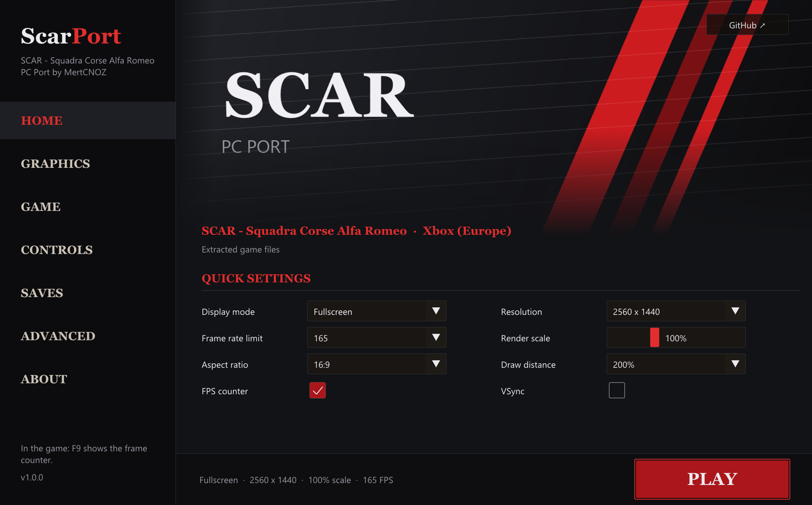
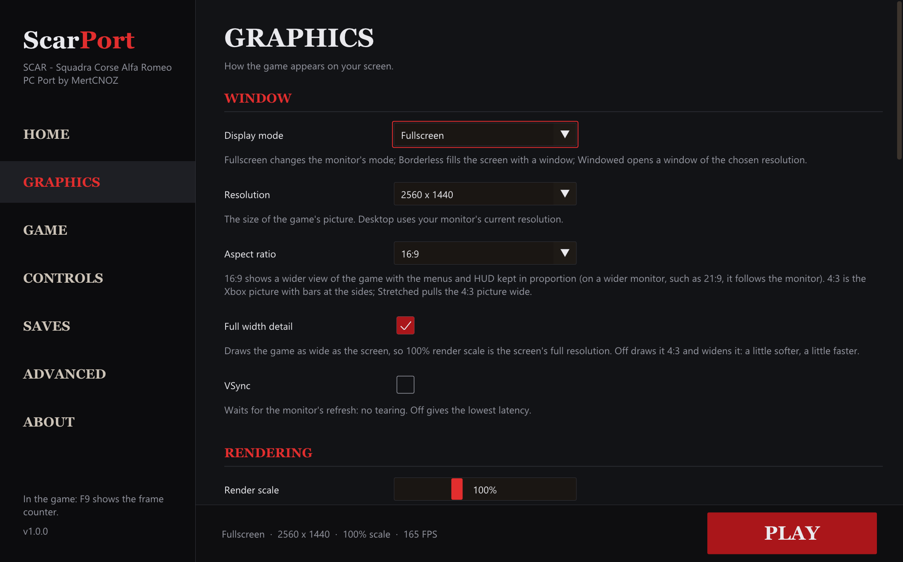
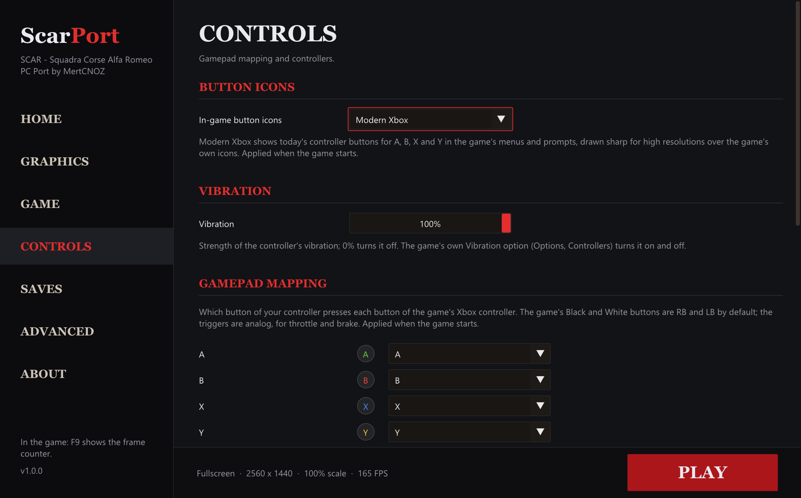

# ScarPort: SCAR - Squadra Corse Alfa Romeo on PC

An unofficial native PC port of the original Xbox version of *SCAR - Squadra Corse Alfa Romeo* (Europe), made by
statically recompiling the game's code with [Xbox XBE Recomp](https://github.com/TGP482/XboxXBERecomp). It comes
with **ScarPort**, a launcher for choosing your copy of the game and setting up graphics and controls.

PC port by [MertCNOZ](https://github.com/MertCNOZ).

**[Download the latest release](https://github.com/MertCNOZ/ScarPort/releases/latest)**

> [!NOTE]
> No game files are included. The port runs from your own legally acquired copy of the game: a disc image (`.iso`)
> or the extracted files of the Xbox (Europe) release.

## Getting started

1. Download the release and unzip it anywhere.
2. Run **ScarPort.exe**.
3. On the **Game** page, choose your disc image (`.iso`, a whole disc dump or an xiso) or the folder of the
   extracted game (the one with `default.xbe`). Nothing is copied; the port reads the game where it is.
4. Press **Play**. The first start compiles the game's code for your PC; this only happens once.

Without a choice in ScarPort, the port also finds the game in an `assets` folder beside it.

## Features

### Display and performance
- Fullscreen, borderless or windowed, at any resolution.
- **Widescreen**: a wider view at your screen's shape (16:9, 21:9) with the menus kept in proportion, or the
  original 4:3.
- **Race HUD at the screen's edges** in widescreen (speedometer, position, lap times, track map), as on a 4:3 TV;
  it can also stay in the middle.
- Render scale from 50% to 200% (supersampling above 100%).
- Frame rate limit up to your monitor's refresh rate or unlimited. The game keeps its speed at any frame rate.
- **Field of view** up to 120% and **draw distance** up to 400% of the game's own.
- An FPS counter (F9 in the game toggles it).

### Picture
- **Car reflections**: the cars' environment reflections, which the console drew each frame, are back on the paint.
- **Bloom**: a soft glow around the brightest parts of the race picture.
- **Sharp text and HUD**: the game's fonts, menus and HUD are upscaled on your PC with smooth outlines, so they stay
  crisp at 4K.
- **Modern Xbox button icons** in the game's menus and prompts, drawn for high resolutions over the game's own; the
  original icons are one click away.
- FXAA, **sharpening** (contrast adaptive) and up to 16x anisotropic filtering.
- **Sharper movies**: the game's 640 x 480 videos are scaled with a sharper filter.
- Texture packs: images in `textures\replacement` replace the game's textures; the game's textures can be dumped
  to make them.

### Game and controls
- The game's five languages (English, French, German, Spanish, Italian), chosen in ScarPort.
- Xbox, PlayStation and Switch controllers, with analog triggers for throttle and brake, hot plugging and vibration.
- Remap every button of the game's controller in ScarPort, with a reset to defaults.
- A controller is needed to play; keyboard and steering wheels are not supported.

### Saves
- Saves live on the port's Xbox hard disk (`hdd\E\UDATA` beside the exe). ScarPort lists them and backs them up.

### Launcher
- English, Turkish and Russian (follows Windows, or chosen on the Advanced page).
- **Updates**: ScarPort looks for a new release on GitHub when it starts (this can be turned off) and installs it
  with one click. Only the port's own files are replaced: saves, settings, texture packs and your game files stay.

### Screenshots

| Graphics | Controls |
| --- | --- |
|  |  |

## System requirements
- Windows 10 or 11, 64-bit
- A graphics card with Direct3D 12
- A game controller

## Building

1. Clone this repository with its submodules, and apply `sdk-patches\*.patch` to `sdk` (`build.bat` does this).
2. Put your extracted game files in the `assets` folder: `default.xbe` with the game's folders beside it.
3. Install Visual Studio 2022 with **Desktop development with C++**, **C++ Clang tools for Windows** and
   **C++ CMake tools for Windows** (`build.bat` offers to add the last two).
4. Run `build.bat`. The first build recompiles the game and takes a while. `SCAR.exe` and `ScarPort.exe` are
   written to `out\build\release`; `release.bat` makes the zip.

## Credits

- [Xbox XBE Recomp](https://github.com/TGP482/XboxXBERecomp) by TGP482, the recompiler and runtime this is built on.
- [XenonRecomp](https://github.com/hedge-dev/XenonRecomp) for the overridable function layout and instruction hooks.
- [Zydis](https://github.com/zyantific/zydis), [toml++](https://github.com/marzer/tomlplusplus),
  [Dear ImGui](https://github.com/ocornut/imgui) and [SDL](https://github.com/libsdl-org/SDL).
- The launcher's banner and icon are drawn by `tools\make_launcher_art.ps1`, and the modern button icons by
  `tools\make_button_icons.ps1`, from shapes and text.

## Legal

Alfa Romeo is a trademark of its owner. This project is not affiliated with or endorsed by Milestone, Black Bean
Games, Alfa Romeo or Microsoft. It contains no game code or assets; you need your own copy of the game.
